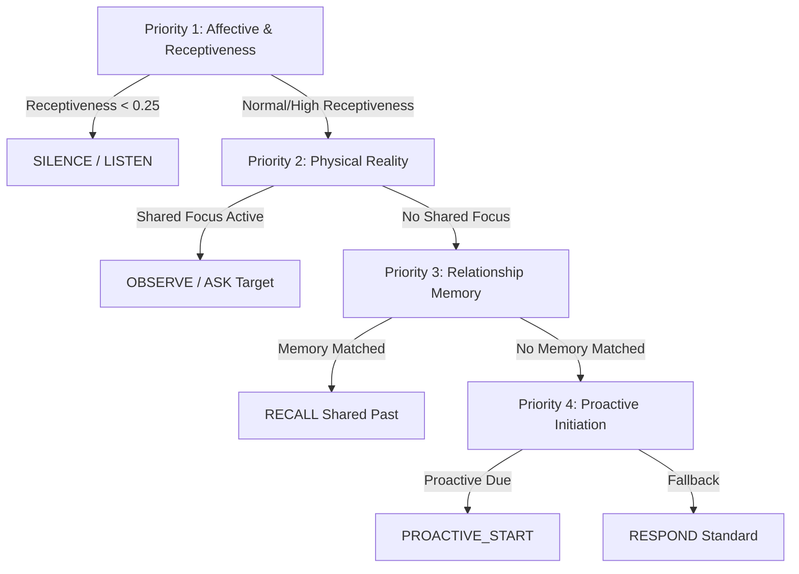

# Companion Cognitive Operating System (CCOS) Architecture (Sprint 53)

본 문서는 Sprint 53에서 구축된 **Companion Cognitive Operating System (CCOS)**의 중앙 오케스트레이션 아키텍처, 4단계 인지 우선순위 정책, Candidate Intent 랭킹 및 통합 의사결정 추적 데이터 흐름을 정의합니다.

---

## 🏛️ 1. 전체 CCOS 아키텍처 구조

```text
[User Input & Real-time Multimodal Signals]
                     │
 ┌───────────────────┼───────────────────┬───────────────────┬───────────────────┐
 ▼                   ▼                   ▼                   ▼                   ▼
[Awareness]   [Shared Reality]   [Affective State]   [Rel Memory]    [Proactive Engine]
 │                   │                   │                   │                   │
 └───────────────────┴───────────────────┼───────────────────┴───────────────────┘
                                         │
                                         ▼
                          [CompanionCognitiveState DTO]
                                         │
                                         ▼
                            [CognitiveDecisionEngine]
                                         │
                                [ConflictResolver]
                  ├─ Priority 1: User Affective & Receptiveness
                  ├─ Priority 2: Physical Present (Awareness / Shared Reality)
                  ├─ Priority 3: Past Life Connection (Relationship Memory)
                  └─ Priority 4: Autonomous Agency (Proactive Initiation)
                                         │
                                [BalanceMonitor]
                  (Meta-Cognition: Suppresses Consecutive Questioning)
                                         │
                                         ▼
                                 [BehaviorDecision]
                  ├─ Intent: RESPOND / ASK / RECALL / ENCOURAGE / OBSERVE / LISTEN / SILENCE / PROACTIVE_START
                  ├─ Confidence & Ranked CandidateIntents List
                  ├─ Deterministic Decision Trace
                  └─ Cognitive Load Budget (Max 2 Prompt Directives)
                                         │
             ┌───────────────────────────┴───────────────────────────┐
             ▼                                                       ▼
  [ContextBuilder LLM Prompt]                                [Avatar & Voice Synchronization]
```

---

## ⚖️ 2. 4-Tier Cognitive Priority Policy



---

## 🎯 3. 핵심 설계 원칙

1. **Integrated Character Brain Perspective**:
   - 개별 분산 엔진이 제각기 발화하는 대신, 모든 인지 레이어(Awareness, Memory, Emotion, Proactive)가 하나의 `CompanionCognitiveState`로 모여 단일 `BehaviorDecision`을 도출.
2. **Intent Ranking & Confidence Tracking**:
   - 단일 Intent 선택을 넘어 `candidate_intents` 상위 후보군(Confidence 내림차순)을 유지하여 LLM 자유도와 유연성 확보.
3. **Cognitive Load Budget (`MAX_CONTEXT_ITEMS = 2`)**:
   - 한 턴에 시각 사물, 기억, 감정, 능동성을 과도하게 나열하는 부자연스러움을 방지하고 최대 2개 핵심 컨텍스트로 정제.
4. **Temporal Context Layer (`TemporalContext`)**:
   - 아침(`MORNING`), 오후(`AFTERNOON`), 저녁(`EVENING`), 심야(`LATE_NIGHT`) 및 주말 여부를 반영하여 시간대 맞춤형 톤 조절.
5. **Meta-Cognition Layer (`ConversationBalanceMonitor`)**:
   - 최근 턴에서 질문(`ASK`, `PROACTIVE_START`)이 연속 발생했을 경우 이를 자가 인지하여 경청(`LISTEN`)이나 편안한 응답으로 밸런스 자동 조절.
6. **Deterministic Decision Trace**:
   - 왜 해당 Intent가 선택되었고 어떤 후보가 억제(Suppressed)되었는지 투명하게 로깅.
