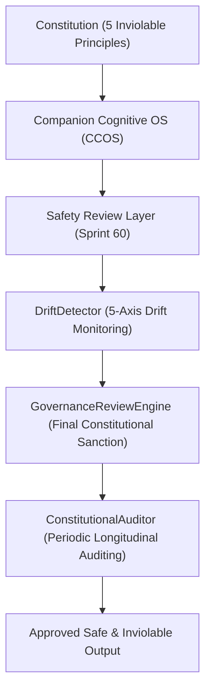

# Governance & Sanction Architecture (Sprint 61) — 코다리 Architect

본 문서는 헌법 계층, CCOS, 안전 계층, 거버넌스 심사기 간의 실행 위계와 아키텍처를 정의합니다.

---

## 🏛️ 1. 거버넌스 실행 위계 (Execution Hierarchy)

---

## 🔍 2. 기억 출처 추적성 (Memory Provenance)

- 모든 회상 발화는 `MemoryProvenance` (대화 출처 ID, 타임스탬프, 신뢰도)를 거버넌스 엔진에 제출하여 검증받아야 합니다.
