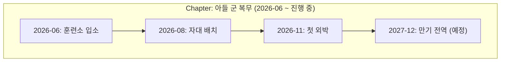

# Life Chapter Specification (Sprint 59)

본 문서는 개별 이벤트를 묶어 거시적 인생 서사를 구성하는 `LifeChapter` 규격을 기술합니다.

---

## 📦 1. LifeChapter DTO

```typescript
interface LifeChapter {
  chapterId: string;
  userId: string;
  title: string;                 // e.g. "아들 군 복무", "홈 가드닝", "창업 프로젝트"
  category: string;              // e.g. "FAMILY", "HOME", "CAREER"
  startDateStr: string;          // "YYYY-MM"
  endDateStr: string;            // "YYYY-MM" or empty if ongoing
  eventIds: string[];            // Linked LifeEvent IDs
  summaryNarrative: string;      // Continuous chapter narrative
  isOngoing: boolean;
  createdAtMs: number;
  updatedAtMs: number;
}
```

---

## 📖 2. Life Chapter Macro Flow Example


