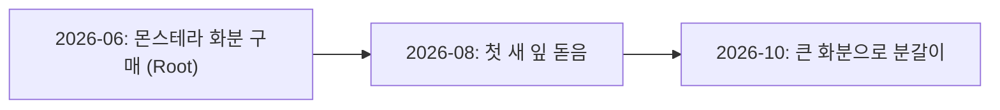

# Life Event Graph Specification (Sprint 56)

본 문서는 시계열 인과 그래프를 구성하는 `LifeEvent` 및 `LifeTimeline` 데이터 모델 규격을 기술합니다.

---

## 📦 1. LifeEvent DTO

```typescript
interface LifeEvent {
  eventId: string;
  title: string;
  category: TimelineCategory;
  timestampMs: number;
  eventDateStr: string;          // e.g. "2026-06" or "2026-06-15"
  importance: number;            // 0.0 ~ 1.0 (Default 0.8)
  confidence: number;            // 0.0 ~ 1.0 (Estimation reliability)
  relatedMemories: string[];     // RelationshipMemory IDs
  parentEventId?: string;        // Upstream causal anchor
  childEventIds: string[];       // Downstream progression events
  narrativeSummary: string;
}
```

---

## 🕸️ 2. Life Event Directed Graph Flow


