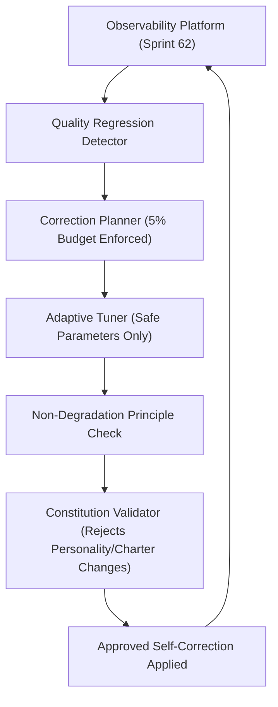

# Self-Improvement Architecture (Sprint 63) — 코다리 Architect

본 문서는 Observability Platform의 측정 데이터를 기반으로 안전한 자율 교정을 수행하는 Adaptive Self-Improvement Engine의 폐쇄 루프 아키텍처를 정의합니다.

---

## 🏛️ 1. 폐쇄 루프 아키텍처 (Closed-Loop Topology)

---

## 🛡️ 2. 3대 안전 방벽
1. **Non-Degradation Principle**: 지표 왜곡(Goodhart's Law) 방지 — 개선으로 인한 핵심 역량 사용률 40% 이상 급감 시 즉시 롤백/거부.
2. **Human Approval Zone (불변 구역)**: `PersonalityVector`, `RelationshipStage`, `Constitution` 수정 시도 100% 원천 차단.
3. **Improvement Budget**: 일일 파라미터 변위 $\le 5.0\%$ 상한 엄수.
