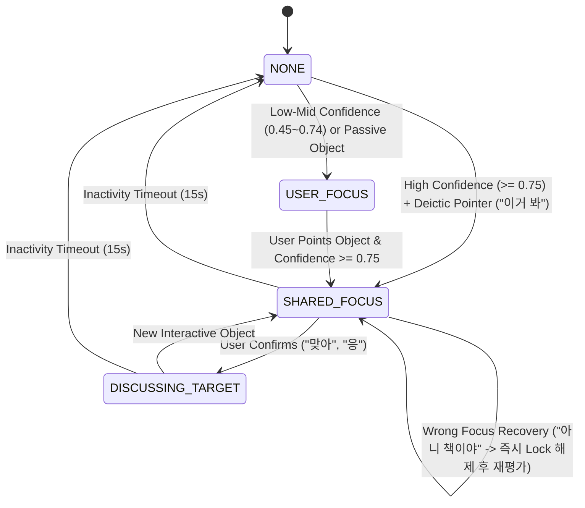

# Shared Reality & Joint Attention Architecture (Sprint 49)

본 문서는 Sprint 49에서 구축된 **Shared Reality & Joint Attention Engine**의 전체 시스템 아키텍처, 4단계 공동 주의 상태 머신 및 시선 동기화 데이터 흐름을 정의합니다.

---

## 🏛️ 1. 전체 아키텍처 구조

```text
[AwarenessContext] (Vision Objects & Confidence)
          +
[Conversation Context] (User Utterance: "이거 봐", "새로 산 컵이야")
          │
          ▼
[JointAttentionEngine]
   ├─ DeicticResolutionEngine ("이거", "저거", "봐봐" 지시어 파싱)
   ├─ UserIntentEstimator (Multi-Object BBox ➔ Top 3 Candidates Focus, Confirmation Status)
   └─ FocusPersistenceManager (3~10s Focus Lock, 15s Timeout, Wrong Focus Recovery)
          │
          ▼
[SharedRealityContext DTO]
          │
          ├─────────────────────────────────────────────────┐
          ▼                                                 ▼
[SharedRealityContextProvider]                    [Avatar Gaze Alignment]
   (Amy Dialogue Directives)                                │
          │                                       [RealtimeFaceRenderer.tsx]
          ▼                                       (Pitch/Roll/Eye Alignment)
[ContextBuilder Prompt] ➔ [LLM]
```

---

## 🔄 2. 4단계 Joint Attention State Machine



---

## 🎯 3. 핵심 설계 원칙

1. **Focus Confidence Thresholding (`MIN_SHARED_FOCUS_CONFIDENCE = 0.75`)**:
   - 0.75 이상일 때만 양방향 공동 주의(`SHARED_FOCUS`)를 형성하고, 0.45~0.74는 일방적 `USER_FOCUS`로 머무름.
2. **Multi-Object Scene Resolution (Top 3 Candidates)**:
   - 컵, 책, 노트북 등 다중 객체가 한 화면에 있을 때 상위 3개 `CandidateFocus`를 관리하고 발화 지시어에 따라 정밀 선택.
3. **Temporal Focus Persistence (3~10s Lock, 15s Timeout)**:
   - 6초 동안 Focus Lock을 걸어 1초 단위 시선 요동(Jitter)을 방지하고, 15초 동안 대화가 없으면 자동으로 NONE으로 복귀.
4. **Wrong Focus Recovery Loop**:
   - 사용자가 "아니 책이야"라고 지적 시 2초 내에 즉시 오인식 타겟을 해제하고 책으로 재설정.
5. **Abstract Attention Anchor (`AttentionAnchor`)**:
   - 기기 해상도 종속 좌표 대신 `USER_FACE`, `LOWER_RIGHT`, `LOWER_LEFT`, `LOWER_CENTER` 등 추상 앵커를 사용하여 렌더러 독립성 유지.
6. **Ephemeral Only (No Long-term Storage in Sprint 49)**:
   - 시각 및 시선 정보는 실시간 휘발성으로 처리되며 영구 저장되지 않음 (Sprint 50 Relationship Memory 준비 단계).
