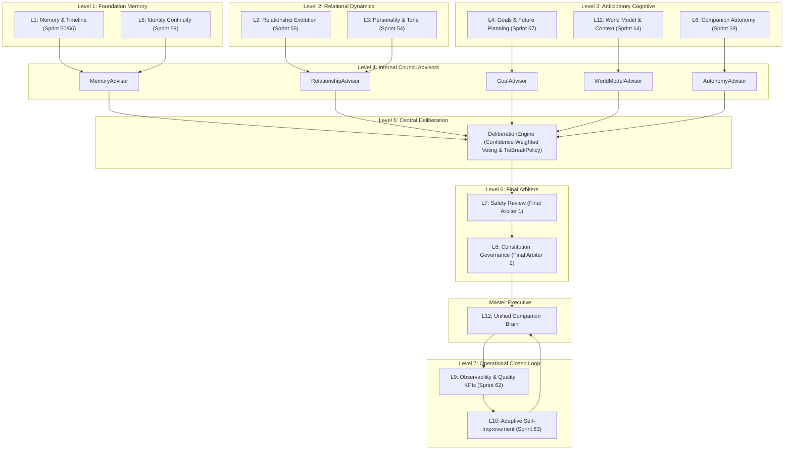

# Unified Companion Brain Architecture (Companion OS v1.0) — 코다리 Architect

본 문서는 Sprint 50~65에서 완성된 L1~L12 전체 인지 아키텍처와 최고 레벨 통합 브레인(Companion Brain)의 토폴로지를 정의합니다.

---

## 🏛️ 1. Companion OS v1.0 12-Layer 아키텍처

---

## ⚖️ 2. 핵심 운영 원칙
1. **Safety & Constitution as Final Arbiters**: 자문위원(Council Member)이 아닌 최종 심판(Final Arbiter)으로 독립 운영.
2. **Deadlock TieBreakPolicy**: 동점 시 `Relationship > WorldModel > Memory > Goal > Autonomy` 우선순위로 해결.
3. **Dual Traceability**: 내부 토론 로그(`internal_trace`)와 사용자 친화적 요약(`user_facing_summary`) 분리.
4. **Graceful Uncertainty**: 정보 부족 시 `UncertaintyLevel.HIGH`로 완곡하고 겸허한 공감 태도 유지.
