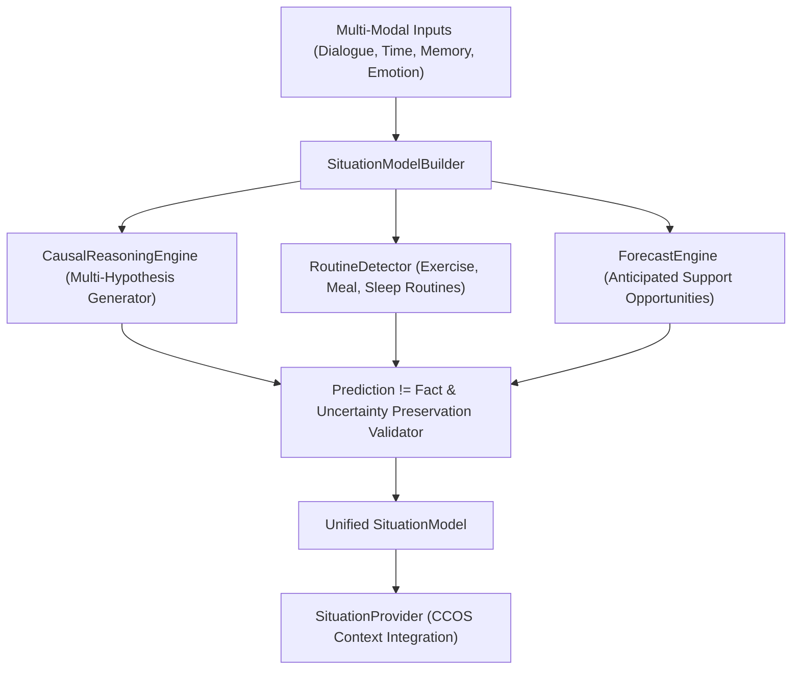

# World Model Architecture (Sprint 64) — 코다리 Architect

본 문서는 사용자의 현재 삶의 맥락, 환경, 루틴, 인과 가설 및 잠재적 지원 기회를 종합 시뮬레이션하는 World Model & Situation Understanding Engine의 아키텍처를 정의합니다.

---

## 🏛️ 1. 상황 이해 및 월드 모델 아키텍처 (World Model Topology)

---

## 🛡️ 2. 신규 BehaviorIntent 4종
1. `UNDERSTAND_CONTEXT`: 현재 사용자의 상황과 환경 맥락 이해
2. `PREDICT_NEED`: 다가오는 일정/상황에 대한 부드러운 지원 기회 제시
3. `SITUATION_RECALL`: 현재 상황과 연결된 과거 패턴 및 사건 회상
4. `CAUSAL_REFLECTION`: 상태와 사건 간의 다중 가설 인과 성찰
