# [SB-1 Audit 3] Cognitive Pipeline Audit

- **작성자**: 🐍 미나리 (Backend Lead)
- **일자**: 2026-09-01
- **스프린트**: SB-1 Character Runtime Foundation

---

## 1. 현재 Interaction Pipeline 흐름도

```mermaid
flowchart TD
    Req["API / Mobile Request"] --> Norm["NormalizedInput (user_id, companion_id)"]
    Norm --> Idemp["Idempotency Guard & StateMachine (ANALYZING)"]
    Idemp --> Tracer["InteractionTracer (user_id, companion_id)"]
    Tracer --> Resolver["[SB-1] CharacterContextResolver.resolve()"]
    Resolver --> RuntimeCtx["CharacterRuntimeContext (Immutable)"]
    RuntimeCtx --> CB["ContextBuilder.build()"]
    
    subgraph Providers["Context Providers (Tier 1 ~ 8)"]
        P0["CharacterIdentityProvider (companion_id)"]
        P1["PersonaContextProvider (user_id)"]
        P2["RelationshipContextProvider (companion_id, user_id)"]
        P3["EmotionContextProvider (companion_id)"]
        P4["MemoryContextProvider (companion_id)"]
        P5["PresenceContextProvider (companion_id)"]
        P6["VisionContextProvider (db)"]
        P7["ConversationHistoryProvider (limit=10)"]
        P8["ReflectionContextProvider (companion_id)"]
    end

    CB --> Providers
    Providers --> LLM["LLMProvider.stream(context)"]
    LLM --> StreamOut["SSE: TEXT_DELTA Streams"]
    StreamOut --> PostProc["Post Processing & Candidate Parsing"]
    PostProc --> Consistency["ConsistencyValidator & RelationshipDelta"]
    Consistency --> AvatarRes["AvatarStateResolver.resolve(companion_id)"]
    AvatarRes --> MsgPersist["MessageRepository.create()"]
    MsgPersist --> Complete["SSE: INTERACTION_COMPLETED"]
```

---

## 2. Character Context 전파 경로 및 주입 지점

- **최상위 주입 지점**: `CompanionOrchestrator.process_interaction()` 라인 85 직후.
- **전파 방식**:
  - `user_input.companion_id`가 지정되지 않은 경우 Resolver를 통해 기본 `default_companion`(지니)으로 확정.
  - 확정된 `runtime_context.scope.companion_id`가 ContextBuilder, Tracer, AvatarStateResolver로 전달되어 일관성 보장.

---

## 3. 하위 호환성(Backward Compatibility) 보장 전략

- 기존 파이프라인 시그니처(`process_interaction(user_input: NormalizedInput)`)를 100% 유지.
- `NormalizedInput.companion_id`가 `None`이어도 Resolver 내부에서 기본 Genie 인격체로 폴백하므로 기존 클라이언트 및 테스트에 전혀 영향 없음.
