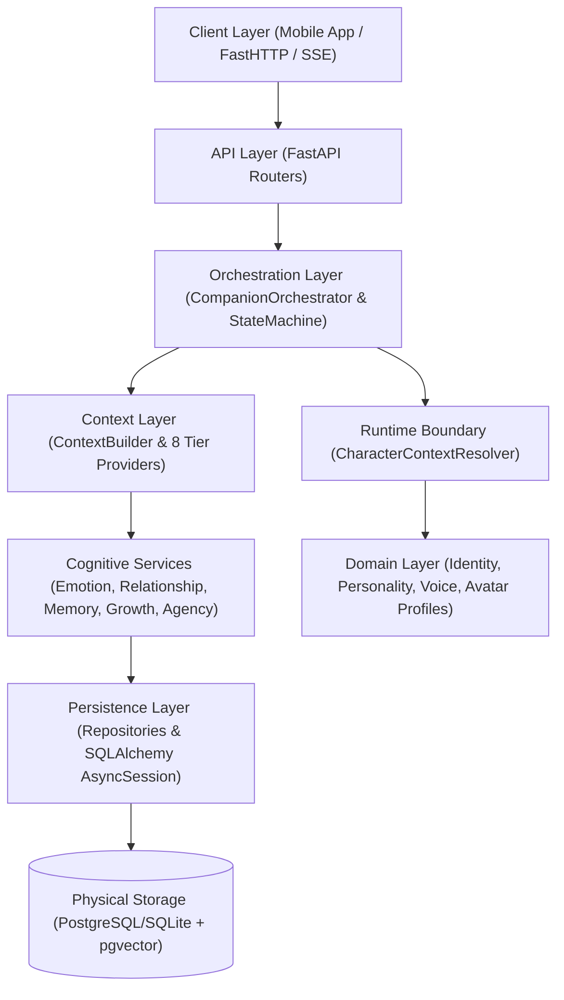

# [SB-1 Audit 1] System Architecture Audit

- **작성자**: 🐟 코다리 (Lead System Architect)
- **일자**: 2026-09-01
- **스프린트**: SB-1 Character Runtime Foundation

---

## 1. 전체 Layer Architecture 및 Composition Root

P009 AI Companion 시스템은 계층형 아키텍처(Layered Clean Architecture)로 엄격히 분리되어 있습니다:



---

## 2. 주요 Data Flow 분석

1. **Request Ingestion**: 
   - 사용자의 텍스트/음성 입력이 `NormalizedInput(user_id, companion_id, conversation_id, content)` 형태로 진입.
2. **Context Resolution (SB-1 확장점)**:
   - `CharacterContextResolver.resolve(user_id, companion_id)`를 통해 불변의 `CharacterRuntimeContext` 생성.
   - `companion_id`가 생략된 경우 기본 인격체인 Genie(`default_companion`)로 자동 매핑.
3. **Context Assembly**:
   - `ContextBuilder`가 `companion_id`를 기반으로 8개 Tier Provider(Identity, Persona, Relationship, Emotion, Memory, Presence, Vision, Reflection)를 순차/병렬 실행하여 LLM 프롬프트 조립.
4. **Cognitive Pipeline & LLM Execution**:
   - LLM Streaming 응답 수신 후 Structured Candidate 파싱, Character Consistency 검증, Relationship Delta 산출, Avatar State 산출.
5. **Presentation & Persistence**:
   - SSE 이벤트를 통해 Avatar State 및 발화 스트림 전송, 대화 히스토리 DB 저장.

---

## 3. Character Runtime Boundary 정의

### 🚨 핵심 발견 및 아키텍처 원칙
- **Companion = Runtime Isolation Owner**:
  - `Companion` 테이블의 `id`(`companion_id`)가 시스템의 기억, 감정, 관계, 아바타, 음성, 에이전시의 물리적/논리적 **Root Tenant Key**입니다.
- **Character Profile = Persona & DNA Specification**:
  - `CharacterProfile`은 해당 Companion이 지닌 성격(Big-5), 가치관, 어조, 배경 스토리의 정의체입니다.
- **CharacterScope = (user_id, companion_id)**:
  - 새로운 `character_id`를 억지로 만들어 DB 스키마와 충돌시키지 않고, 기존의 `companion_id`를 런타임 스코프로 승격합니다.

---

## 4. Runtime Context Injection Point

- **진입 지점**: `CompanionOrchestrator.process_interaction()` 최상단
- **역할**:
  ```python
  runtime_context = await self.context_resolver.resolve(
      user_id=user_input.user_id,
      companion_id=user_input.companion_id
  )
  ```
- **전파 경로**: `InteractionTracer` 및 향후 인지 엔진에 `runtime_context.scope` 불변 전파.

---

## 5. Architecture Risk & 완화 전략

1. **단일 세션 내 인격 오염 위험 (Context Contamination)**:
   - **완화**: `CharacterRuntimeContext`를 `@dataclass(frozen=True)`로 불변화하고, Resolver 캐시 키를 `(user_id, companion_id)` 복합키로 관리.
2. **하위 호환성 파괴 위험 (Regression)**:
   - **완화**: 기존 호출 방식(`companion_id` 생략) 시 `default_companion`을 반환하여 기존 57개 테스트 및 단일 캐릭터 환경을 100% 보존.
