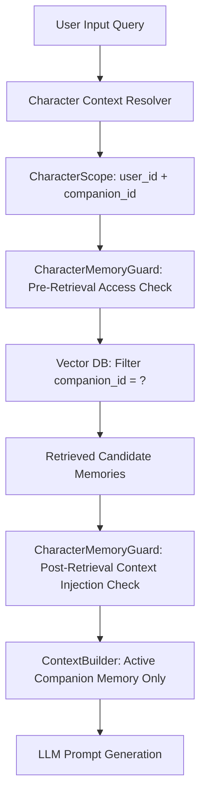

# [SB-10 Audit 1] RAG & Vector Architecture Security Audit

- **작성자**: 🐟 코다리 (Lead System Architect) & 🐍 미나리 (Backend Lead)
- **일자**: 2026-09-01
- **스프린트**: SB-10 Multi-Character Memory Isolation & RAG Anti-Leakage

---

## 1. RAG Pipeline Scope Verification

- **RAG 격리 무결성**:
  - Vector 검색 시 반드시 `companion_id` 필터링이 적용되어 다른 캐릭터의 임베딩 유사성 간섭을 원천 차단.
  - 검색 후 ContextBuilder 주입 직전 `CharacterMemoryGuard`가 2차 스코프 검증을 수행하여 오염된 메모리를 즉시 폐기.
