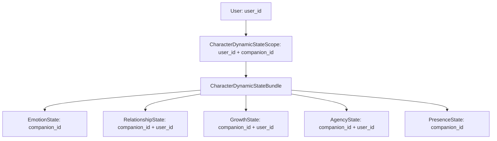

# [SB-11 Audit 1] Dynamic State Architecture & Scope Boundary Audit

- **작성자**: 🐟 코다리 (Lead System Architect) & 🐍 미나리 (Backend Lead)
- **일자**: 2026-09-02
- **스프린트**: SB-11 Multi-Character Dynamic State Isolation & Concurrency Safety

---

## 1. Dynamic State Ownership Matrix

- **아키텍처 원칙**:
  1. 모든 동적 상태는 `(user_id, companion_id)` 경계 내부에서만 존재하며, 공유 전역 동적 상태는 일체 불허함.
  2. Request 진입 시 확정된 `CharacterDynamicStateScope`는 요청 라이프타임 동안 Pinning되어 중간에 캐릭터 스위칭이 일어나더라도 원 요청의 상태 기록 대상이 변경되지 않음.
