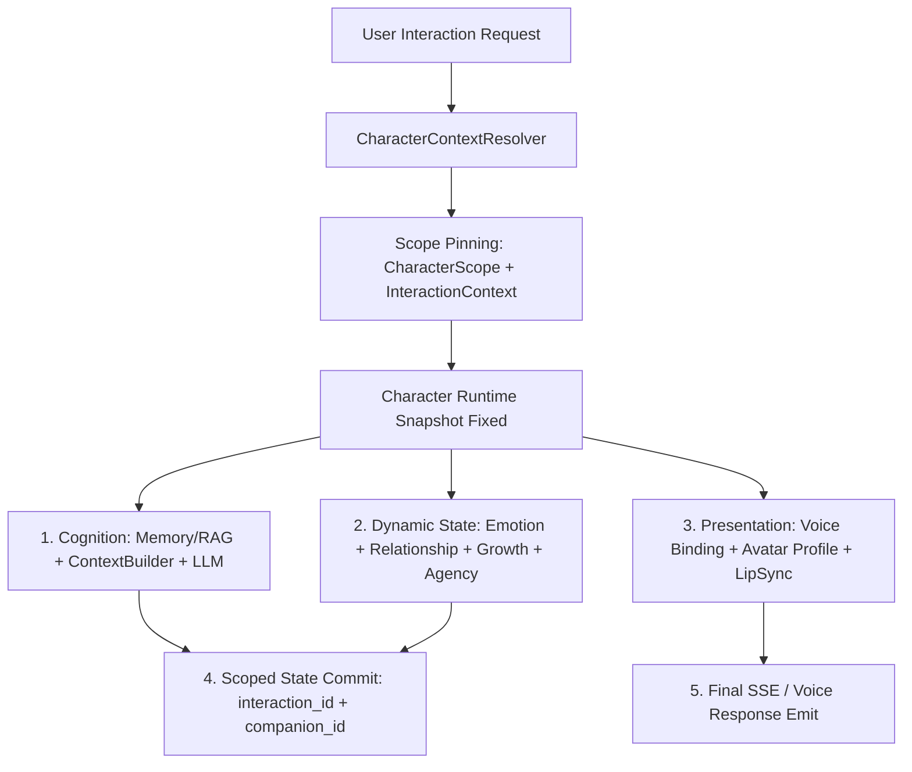

# [SB-12 Audit 1] Orchestration Architecture & End-to-End Scope Integrity Audit

- **작성자**: 🐟 코다리 (Lead System Architect) & 🐍 미나리 (Backend Lead)
- **일자**: 2026-09-02
- **스프린트**: SB-12 Multi-Character Companion Orchestration & End-to-End Scope Integrity

---

## 1. End-to-End Orchestration Pipeline

- **절대 불변 원칙**:
  - 요청 진입 시 생성된 `CompanionInteractionContext`는 불변(Immutable)이며, 전체 파이프라인에서 `activeCharacter`를 중간에 재조회하지 않고 Pinned Scope를 끝까지 유지함.
