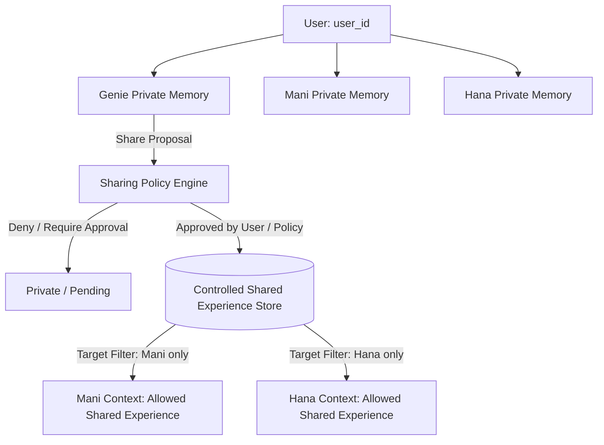

# [SB-13 Audit 1] Controlled Shared Experience Architecture

- **작성자**: 🐟 코다리 (Lead System Architect) & 🐍 미나리 (Backend Lead)
- **일자**: 2026-09-02
- **스프린트**: SB-13 Controlled Shared Experience & Character-to-Character Information Sharing

---

## 1. Core Architectural Model

- **철학 (Core Philosophy)**:
  1. **PRIVATE BY DEFAULT**: 모든 대화와 기억은 캐릭터 개별 Private Memory에 격리 저장됨.
  2. **SHARE ONLY BY POLICY**: 명시적인 Proposal ➔ Policy Engine ➔ 승인 단계를 거친 데이터만 공유 스토어에 등재됨.
  3. **NO DIRECT MEMORY ALIAS / COPY**: Character A가 Character B의 메모리에 직접 쓰거나 복사하는 행위는 100% 금지됨.
  4. **PROVENANCE & AUDITABLE**: 모든 공유 경험은 `source_character_id`, `target_character_ids`, `source_interaction_id` 출처를 영속 보존함.
