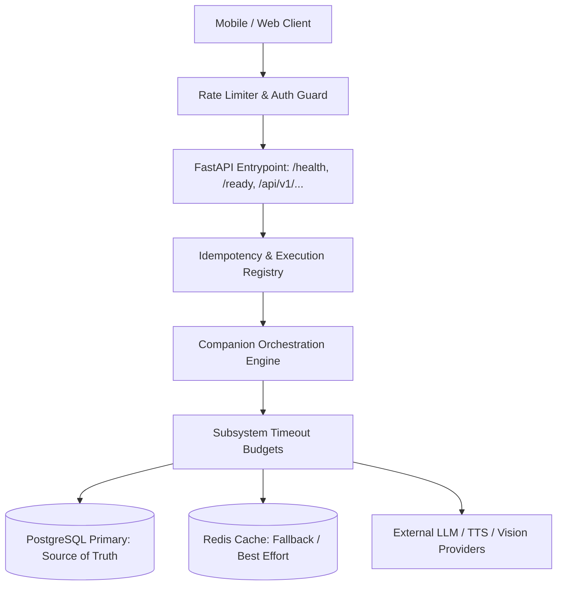

# [SB-14 Audit 1] Production Hardening & Reliability Architecture Audit

- **작성자**: 🐟 코다리 (Lead System Architect) & 🔐 방대장 (DevOps/Security Lead)
- **일자**: 2026-09-02
- **스프린트**: SB-14 Production Hardening & Reliability Engineering

---

## 1. Production Architecture Overview

- **하드닝 핵심 10대 원칙**:
  1. Security First & Fail Closed
  2. Transaction Safety & No Partial Commits
  3. Idempotency Key (`interaction_id`) Protection
  4. Explicit Timeout Budgets across Subsystems
  5. Graceful Degradation on External/Cache Failures
  6. Structured Logging & Privacy Redaction
  7. Mobile Network & State Resilience
  8. Rate Limiting & Cost Spike Prevention
  9. Liveness (`/health`) & Readiness (`/ready`) Separation
  10. Full Backward Compatibility (SB-1 ~ SB-13)
