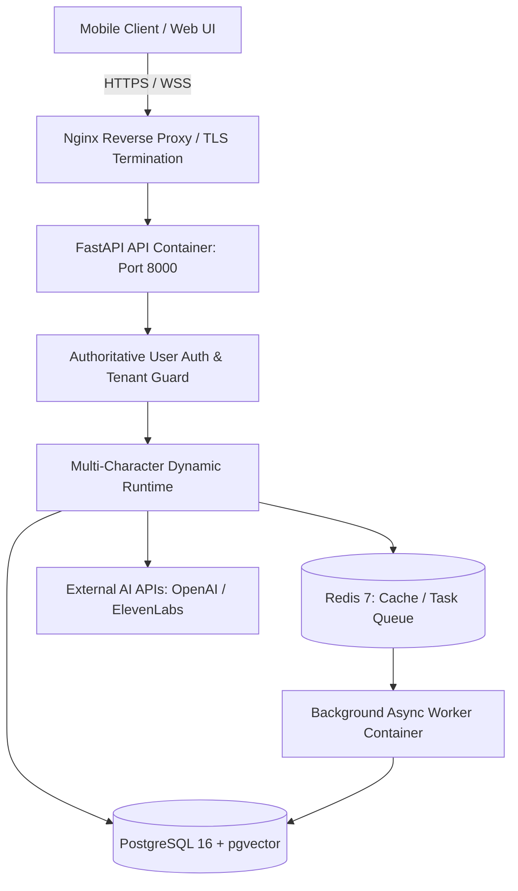

# [SB-15 Audit 1] Production Architecture & Multi-User Server Architecture

- **작성자**: 🐟 코다리 (Lead System Architect) & 🔐 방대장 (DevOps/Security Lead)
- **일자**: 2026-09-02
- **스프린트**: SB-15 Production Deployment & Multi-User Server

---

## 1. Multi-User Production Platform Architecture

- **핵심 목표**:
  - 단일 사용자 PC 실행 앱에서 **다중 사용자(Multi-Tenant)가 독립된 AI Companion 군단을 운영할 수 있는 상용 클라우드 플랫폼**으로 전환.
