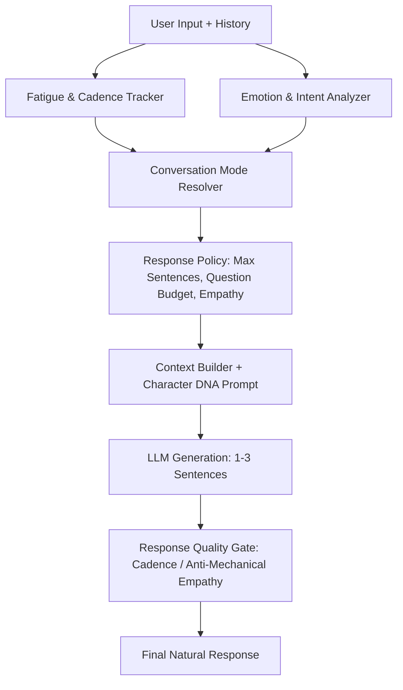

# [SB-17 Doc 1] Natural Conversation & Dynamic Cadence Architecture

- **작성자**: 🐟 코다리 (Lead System Architect) & ✍️ Amy (AI Growth & Persona Lead)
- **일자**: 2026-09-02
- **스프린트**: SB-17 Natural Conversation, Dynamic Cadence & Quiet Empathy

---

## 1. Natural Conversation Architecture Overview

- **핵심 철학**:
  - AI가 항상 길게 설명하거나 질문할 필요는 없다.
  - 사용자가 지치고 힘들 땐 질문을 멈추고 1~2문장으로 곁을 지키는 **조용한 공감(Quiet Empathy)**을 제공한다.
