# [SB-2 Architecture 3] Active Character Switching & Execution Flow

- **작성자**: 🐍 미나리 (Backend Lead) & 🏃 정대리 (QA Lead)
- **일자**: 2026-09-01
- **스프린트**: SB-2 Multi-Character Persistence & Registry

---

## 1. 원자적 캐릭터 전환 시퀀스 (Atomic Switching Flow)

```mermaid
sequenceDiagram
    autonumber
    actor User as Client / User
    participant API as Characters Endpoint
    participant Service as CharacterRegistryService
    participant Repo as CharacterRegistryRepository
    participant DB as Database Session
    participant Resolver as CharacterContextResolver

    User->>API: POST /api/v1/characters/{companion_id}/activate
    API->>Service: set_active_companion(user_id, companion_id)
    Service->>Repo: set_active_companion(user_id, companion_id)
    
    rect rgb(30, 41, 59)
        Note over Repo,DB: Atomic Transaction Boundary
        Repo->>DB: SELECT companion WHERE id=:cid AND user_id=:uid
        alt Companion Not Found or Not Owned
            DB-->>Repo: None
            Repo-->>Service: Raise PermissionError / NotFound
            Service-->>API: 403 Forbidden / 404 Not Found
            API-->>User: Error Response
        else Ownership Verified
            Repo->>DB: INSERT/UPDATE user_character_preferences (active_companion_id=:cid)
            Repo->>DB: COMMIT Transaction
        end
    end

    Service->>Resolver: Invalidate Active Cache for user_id
    Service-->>API: Active Character Summary
    API-->>User: 200 OK (active_companion_id, character details)
```

---

## 2. 정밀 캐시 무효화 정책 (Selective Cache Invalidation Policy)

- **Context Cache Key**: `(user_id, companion_id)`
  - 개별 캐릭터의 불변 설정 컨텍스트(`genie_ctx`, `sua_ctx`)는 전환 후에도 무효화하지 않고 **캐시를 그대로 유지**합니다. (불필요한 DB 재조회 방지)
- **Active Mapping Cache Invalidation**:
  - `active_companion_id`를 메모리에 캐싱하고 있는 경우에 한하여, 캐릭터 전환 완료 즉시 해당 사용자의 `active_companion_id` 캐시만 무효화합니다.
- **결과**:
  - 지니 대화 ➔ 수아 전환 ➔ 수아 대화 ➔ 지니 재전환 시, 캐시 오염 없이 100% 독립적인 컨텍스트가 즉시 로드됩니다.
