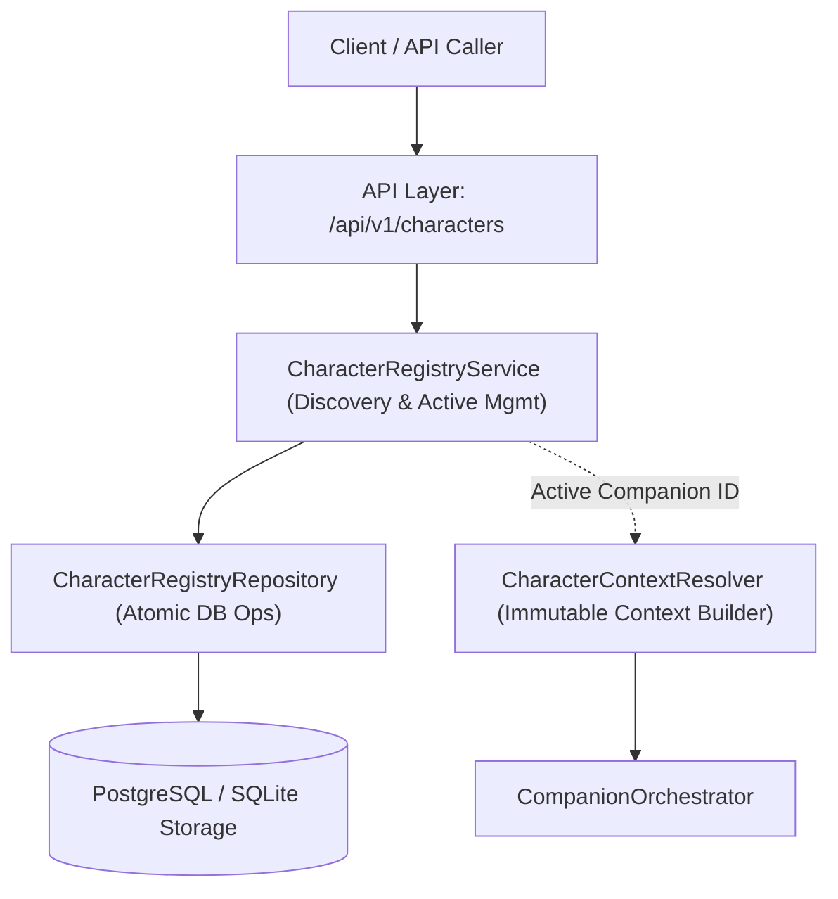

# [SB-2 Architecture 2] Character Registry Architecture

- **작성자**: 🐟 코다리 (Lead System Architect) & 🧭 세종이 (PM)
- **일자**: 2026-09-01
- **스프린트**: SB-2 Multi-Character Persistence & Registry

---

## 1. Registry Layer Architecture

---

## 2. 레이어별 책임 분리 (Single Responsibility)

| 구성 요소 | 핵심 역할 | 금지된 역할 (Out of Scope) |
| :--- | :--- | :--- |
| **`CharacterRegistryRepository`** | `companions` 및 `user_character_preferences` 대상 CRUD 및 Atomic Transaction 수행 | 비즈니스 검증, 인지 상태 계산 |
| **`CharacterRegistryService`** | 보유 캐릭터 목록 집계, Lazy Bootstrap 수행, 소유권 검증, 활성 캐릭터 전환, 캐시 무효화 통지 | 런타임 프롬프트 빌드, 메모리 검색 |
| **`CharacterContextResolver`** | 주어진 `(user_id, companion_id)`에 대해 불변의 `CharacterRuntimeContext` 구성 및 캐싱 | 캐릭터 목록 관리, Active 상태 DB 변경 |
| **API Endpoints (`characters.py`)** | DTO 매핑, HTTP 상태 코드(403/404/200) 변환 | 직접 DB 접근, 비즈니스 로직 처리 |

---

## 3. Domain Model vs API Response Schema 분리

- **도메인 모델 (`CharacterSummary`)**:
  - `companion_id`, `name`, `role_title`, `avatar_preview`, `voice_name`, `is_active`
- **FastAPI 응답 스키마 (`CharacterSummaryResponse`, `ActivateCharacterResponse`)**:
  - Pydantic BaseModel을 사용하여 OpenAPI 스펙을 정의하고 내부 도메인 변경으로부터 API 스펙 보호.
