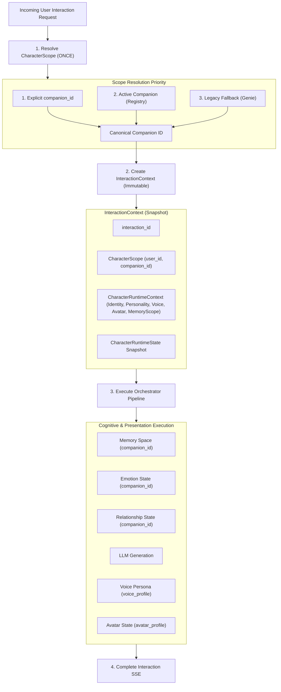

# [SB-3 Architecture 1] Interaction Scope & Snapshot Isolation Architecture

- **작성자**: 🐟 코다리 (Lead System Architect) & 🐍 미나리 (Backend Lead)
- **일자**: 2026-09-01
- **스프린트**: SB-3 Character Switching & Full Context Isolation

---

## 1. Interaction Scope Architecture Overview

---

## 2. Interaction Snapshot Isolation 원칙

1. **단일 상호작용 불변성 (Single Interaction Immutability)**:
   - 상호작용 시작 시 생성된 `InteractionContext`는 상호작용이 끝날 때까지 절대 변경되지 않습니다.
2. **동적 전환과의 격리 (Decoupled from Live Switching)**:
   - 상호작용 $A$가 진행 중인 도중 사용자가 다른 클라이언트 또는 백그라운드에서 활성 캐릭터를 $B$로 전환하더라도, 상호작용 $A$는 원래 캐릭터의 메모리, 감정, 음성, 아바타를 유지하며 정상 완결됩니다.
   - 이후 시작되는 새로운 상호작용 $B$부터 전환된 활성 캐릭터를 참조합니다.
