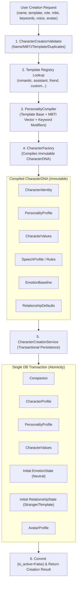

# [SB-4 Architecture 1] Character Creation Architecture & Provisioning Flow

- **작성자**: 🐟 코다리 (Lead System Architect) & 🧭 세종이 (PM Lead)
- **일자**: 2026-09-01
- **스프린트**: SB-4 Character Creation Engine & Personality DNA Factory

---

## 1. Character Provisioning Flow

---

## 2. 핵심 원칙 준수

1. **생성과 활성화 분리**: 생성 시 `is_active = False`이며 기존 활성 캐릭터를 유지합니다.
2. **원자적 롤백**: DB 중간 실패 시 생성 중인 모든 엔티티가 완전 롤백되어 고아 데이터가 남지 않습니다.
3. **일반화된 팩토리**: 특정 캐릭터 전용 로직이 아닌, 템플릿과 성격 컴파일러 기반의 범용 `CharacterFactory`를 사용합니다.
