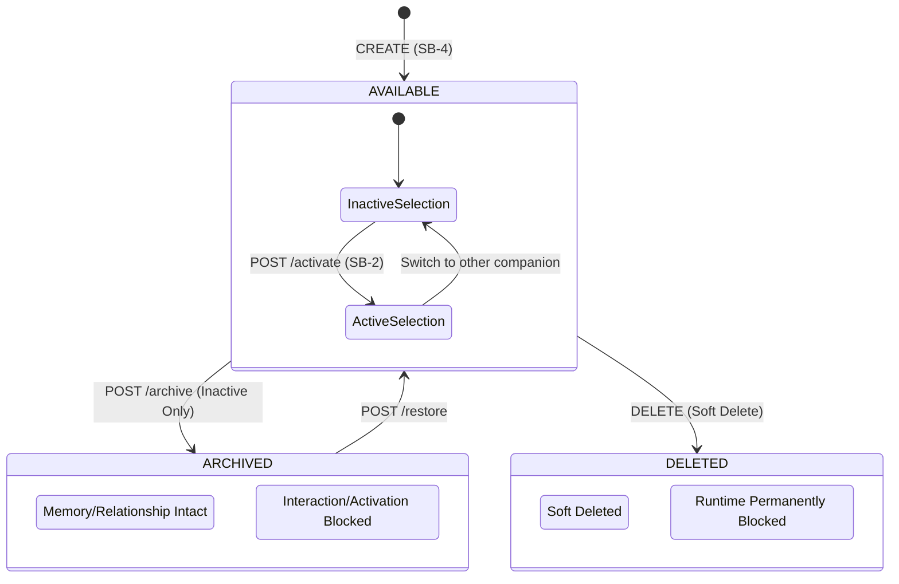

# [SB-5 Architecture 1] Character Lifecycle Architecture & State Machine

- **작성자**: 🐟 코다리 (Lead System Architect) & 🧭 세종이 (PM Lead)
- **일자**: 2026-09-01
- **스프린트**: SB-5 Character Lifecycle Management & Safe Evolution

---

## 1. Character Lifecycle State Machine

---

## 2. Active Selection과 Lifecycle Status의 명확한 분리

- **`lifecycle_status` (Companion 수준)**: `AVAILABLE`, `ARCHIVED`, `DELETED`
- **`active_companion_id` (UserPreference 수준)**: 현재 대화 활성 캐릭터
- 활성 캐릭터는 대화 중이므로 `ARCHIVED` 또는 `DELETED` 상태로 직접 전이될 수 없으며, 사용자가 다른 캐릭터를 먼저 활성화한 후 조작해야 합니다.
