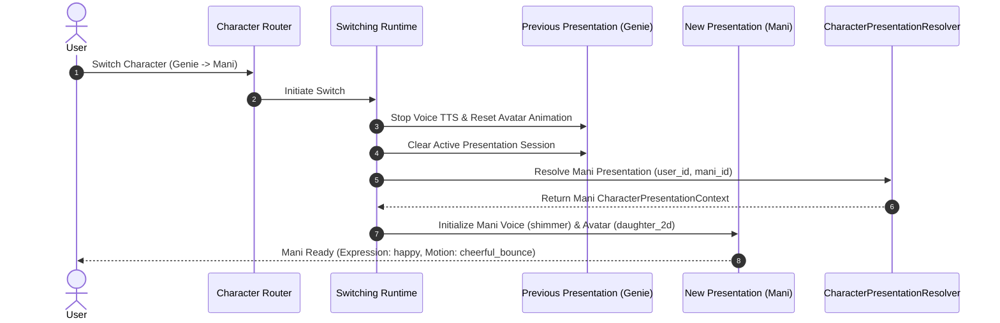

# [SB-6 Architecture 5] Profile Binding & Runtime Resolution Flow

- **작성자**: 🐍 미나리 (Backend Lead) & 🏃 정대리 (QA Lead)
- **일자**: 2026-09-01
- **스프린트**: SB-6 Character Presentation Identity & Profile Binding

---

## 1. Character Switching & Presentation Synchronization Flow

- 이전 캐릭터의 오디오/애니메이션 잔상이 남지 않도록 완벽한 Stop & Reset 후 신규 캐릭터 컨텍스트를 로딩합니다.
