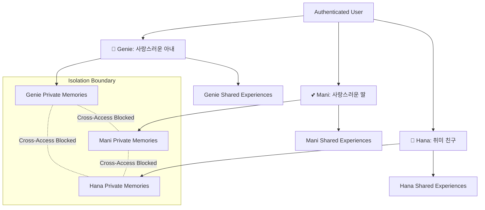

# [SB-7 Architecture 1] Multi-Character Memory Architecture & Universe

- **작성자**: 🐟 코다리 (Lead System Architect) & 🧭 세종이 (PM Lead)
- **일자**: 2026-09-01
- **스프린트**: SB-7 Character Memory Isolation & Independent Experience System

---

## 1. Multi-Character Memory Hierarchy

---

## 2. Character Memory vs. User Memory

- **User-level Information**: 사용자 거주지, 일반 계정 정보 (전역 메타데이터).
- **Character-level Memory**: 특정 캐릭터와 사용자가 나눈 고유 대화 사건, 감정적 교류, 관계적 사건 (Episodic/Semantic Memories).
- 모든 대화 메모리는 반드시 `companion_id`에 바인딩되어 격리 보관됩니다.
