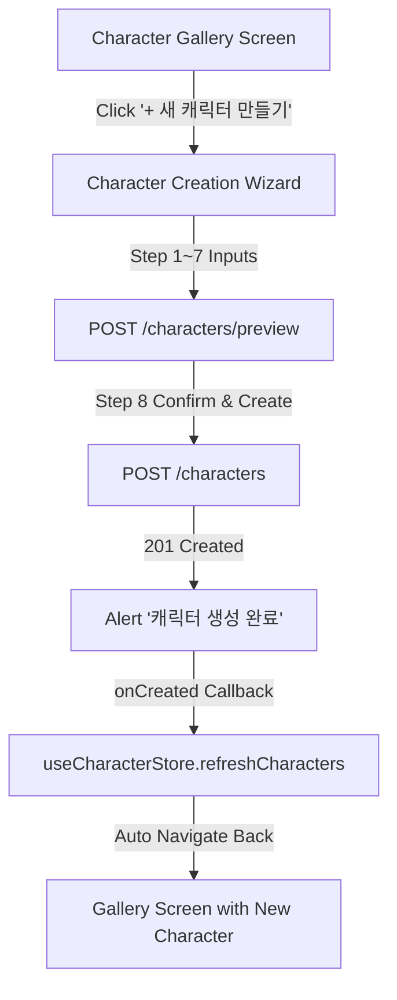

# [SB-9 Architecture 7] Character Creation Wizard to Gallery Navigation Integration

- **작성자**: ✍️ Amy (Growth/UX Lead) & 🧭 세종이 (PM Lead)
- **일자**: 2026-09-01
- **스프린트**: SB-9 Multi-Character Mobile Studio & Real-Time Switching UX

---

## 1. Creation to Gallery Flow

