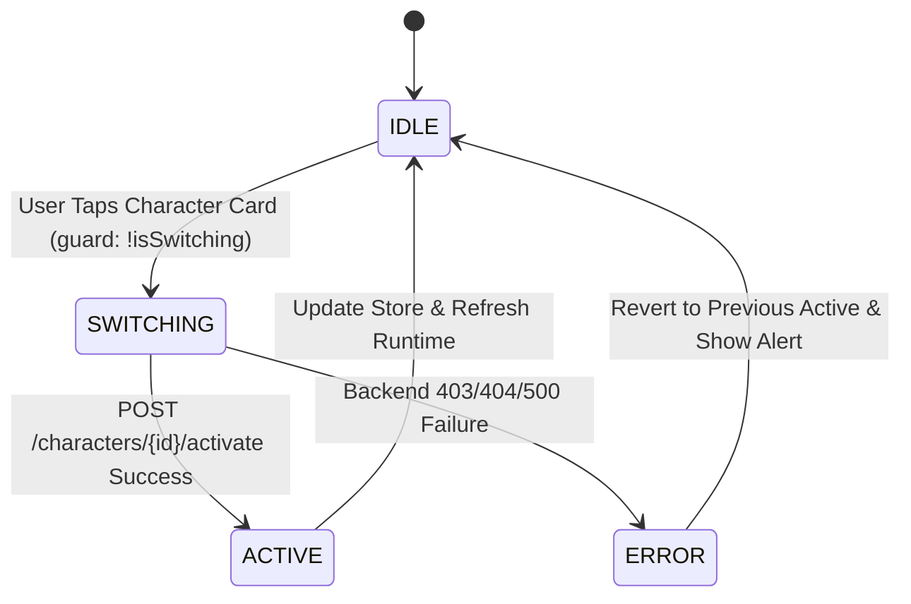

# [SB-9 Architecture 4] Atomic Server-Confirmed Character Switching Flow

- **작성자**: 🐟 코다리 (Lead Architect) & 🏃 정대리 (QA Lead)
- **일자**: 2026-09-01
- **스프린트**: SB-9 Multi-Character Mobile Studio & Real-Time Switching UX

---

## 1. Switching State Machine & Race Condition Guard

- **Race Condition 방어**: `isSwitching === true` 동안 발생하는 모든 탭 이벤트는 즉시 drop됩니다.
- **Server Confirmation**: 서버 응답 수신 전까지 `activeCharacterId`를 미리 바꾸지 않습니다.
